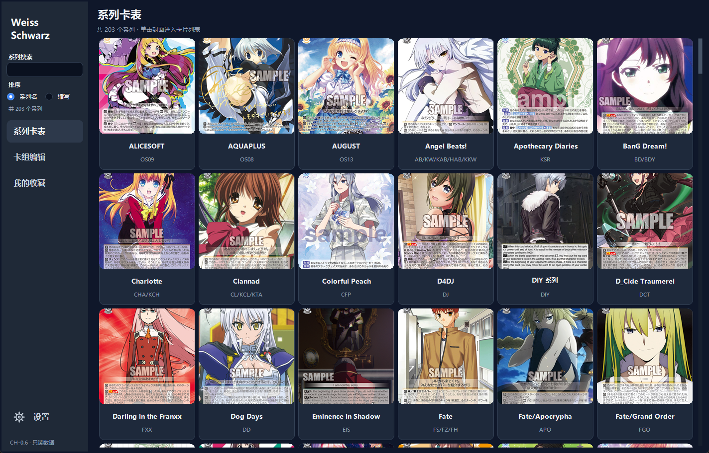
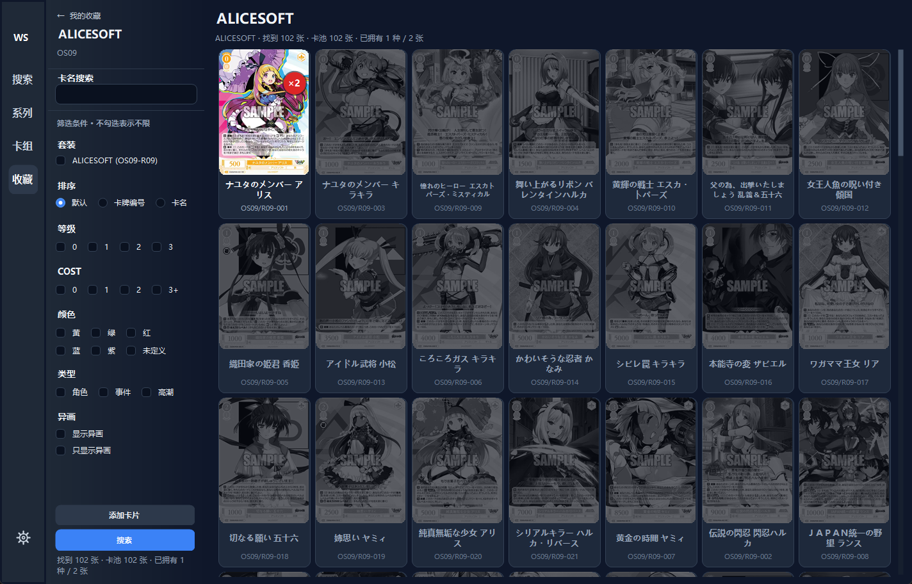
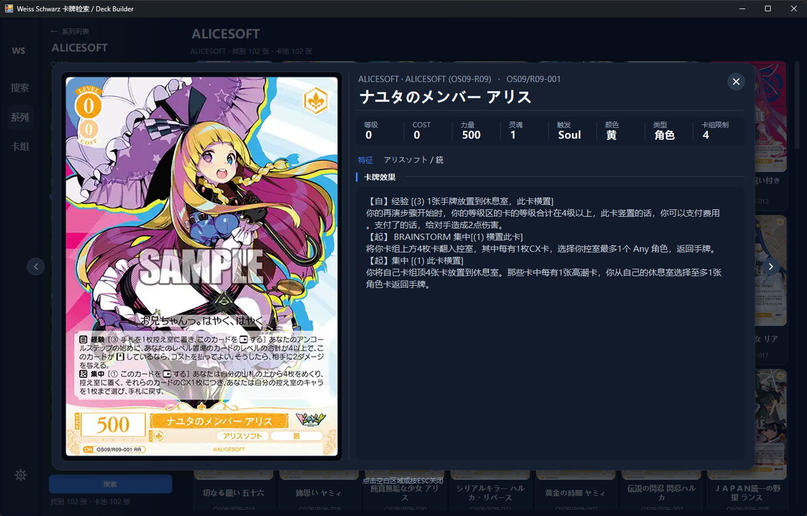

# Weiss Schwarz Deck Builder (Standalone)

一个独立的 WinForms 卡牌检索/构筑辅助程序。它直接读取游戏目录中的
`Weiss Schwarz_Data\StreamingAssets`；除手动安装卡表压缩包、保存/删除卡组、保存
“我的收藏”的拥有数量、以及在“编辑卡片”里保存卡片外，不写入、不修改任何游戏文件
（卡组导出只写到 `DeckBuilder` 同级的 `Output` 文件夹；写卡前会先把原
`CardData.txt` 备份为 `.bak`）。

当前版本采用**两级导航**：先按系列封面浏览全部系列（当前数据为 203 个），进入系列后再用左侧筛选栏检索卡牌。
搜索结果支持图片预览、卡牌详情和日文名显示，作为后续卡组编辑功能的底座。另一个同级页面
“我的收藏”复用同一套封面与卡表，用颜色和红色数量标签显示自己拥有的卡，并把数量保存在
`StreamingAssets\MyCollocation`；第四个页面“编辑卡片”复用同一套封面与卡表来修改或添加卡片。








## 运行

已编译程序：

```
DeckBuilder\dist\WeissDeckBuilder.exe
```

首次运行会按以下顺序寻找数据目录：

1. 命令行参数 `--data "<路径>"`（可指向 `StreamingAssets` 或其 `Cards` 子目录）
2. 环境变量 `WS_DECKBUILDER_DATA`
3. 程序目录下的 `data-root.txt`（文件内写路径，支持相对路径）
4. 从程序目录和当前目录向上查找 `Weiss Schwarz_Data\StreamingAssets`

示例：

```powershell
.\DeckBuilder\dist\WeissDeckBuilder.exe --data "E:\Weiss Schwarz CH-0.6\Weiss Schwarz_Data\StreamingAssets"
```

左侧导航最下方的「启动游戏」（在「设置」上方）用 `noUpdate` 参数启动同目录的
`Weiss Schwarz.exe`，效果和双击 `不热更启动游戏.lnk` 完全一致：游戏不会去跑
`更新卡牌数据.exe`，卡表不会被自动更新覆写，刚写好的卡牌可以直接进游戏验证。
启动后 DeckBuilder 保持打开；游戏已经在运行时只弹一句提示，不会开第二个进程；
找不到 exe 时这个入口直接变灰，用 `--data` 或环境变量 `WS_GAME_EXE`
（指向 exe 的完整路径）可以告诉它游戏在哪。

## 安装（换电脑 / 给朋友用）

发布包解压后就是一个 `DeckBuilder` 文件夹：把它放到游戏目录里（和 `Weiss Schwarz.exe` 同一层），
然后二选一：

1. 双击 `DeckBuilder\安装.cmd`：校验程序文件与卡表目录，并把卡组同步插件复制到
   `BepInEx\plugins\WeissSchwarzDeckSync\`（需要先装 BepInEx 5.4.23.x；只想用独立程序就加 `-NoPlugin`）；
2. 不装插件也可以直接双击 `DeckBuilder\dist\WeissDeckBuilder.exe`。

命令行用法：

```powershell
# 只预演，不写任何文件
powershell -NoProfile -ExecutionPolicy Bypass -File DeckBuilder\install.ps1 -Preview
# 明确指定游戏目录（DeckBuilder 不在游戏目录里时）
powershell -NoProfile -ExecutionPolicy Bypass -File DeckBuilder\install.ps1 -GameRoot "D:\Steam\steamapps\common\Weiss Schwarz"
# 只装独立程序，不装插件
powershell -NoProfile -ExecutionPolicy Bypass -File DeckBuilder\install.ps1 -NoPlugin
```

安装脚本只做三件事：定位游戏目录、校验 `dist\` 里的程序和 `StreamingAssets\Cards` 是否存在、
复制插件 DLL（哈希相同就跳过，不同则先备份成 `*.bak-yyyyMMdd-HHmmss`）。它不会改卡表、卡组、
收藏和游戏配置，也**不会**替你写 `data-root.txt` —— 那个文件里是本机绝对路径，换电脑就失效，
只有「DeckBuilder 必须留在游戏目录之外」时才加 `-WriteDataRoot` 生成。

**放在哪最稳**：`<游戏目录>\DeckBuilder\`。程序靠“从 exe 目录向上查找
`Weiss Schwarz_Data\StreamingAssets`”定位卡表，与盘符、Steam 库位置、游戏文件夹名都无关；
导出目录 `Output` 也固定在 `DeckBuilder` 的同级，所以文件夹名请保持 `DeckBuilder`。

## 安装卡表压缩包

把卡表压缩包拖到窗口任意位置，或打开 `设置 → 存储 → 卡表压缩包 → 选择压缩包…`，
程序会把 `Cards` / `AlternateArtwork` 写入当前数据目录的 `StreamingAssets`，重载系列后
直接打开导入的系列；只有补充文件的包不新增系列，会提示写入的文件数。支持 `.zip`、
`.rar`、`.7z`，包括 WinRAR / 7-Zip 的固实压缩包；
ZIP 使用系统自带的 `System.IO.Compression`，RAR / 7z 使用随程序分发的 SharpCompress。

压缩包需要镜像游戏目录，例如：

```
Weiss Schwarz_Data/StreamingAssets/Cards/Stella Sora/SingleSetData.txt
Weiss Schwarz_Data/StreamingAssets/Cards/Stella Sora/W140/CardData.txt
Weiss Schwarz_Data/StreamingAssets/Cards/Stella Sora/W140/*.png
```

也可以只放补充文件，例如给已安装系列补图片或效果文件：

```
Weiss Schwarz_Data/StreamingAssets/Cards/Stella Sora/W140/*.png
Weiss Schwarz_Data/StreamingAssets/Cards/Stella Sora/CommonEffects.txt
Weiss Schwarz_Data/StreamingAssets/AlternateArtwork/Stella Sora/*.png
```

安装条件只看压缩包里是否存在 `Cards` 或 `AlternateArtwork` 下的有效文件，至少一个
即可，不再强制要求 `SingleSetData.txt` 或每个 `Folder` 都有卡表。若压缩包里带有
`SingleSetData.txt`，仍会解析系列名并尽量统计卡数；缺少或损坏的卡表不会单独阻止
安装。压缩包里的其他文件、绝对路径和 `..` 路径会被忽略或拒绝。旧系列用 GBK 写入的
中文文件名可以正常识别；同名系列里的同名文件会被覆盖（压缩包里没有的旧文件不会被
删除）。带密码的压缩包暂不支持，失败时状态栏显示“添加失败”并弹窗说明原因。

## 构建

构建脚本使用游戏自带的 Roslyn 和 .NET Framework 4.7.2 引用程序集，不依赖
Visual Studio 或 NuGet：

```powershell
powershell.exe -NoProfile -ExecutionPolicy Bypass -File .\DeckBuilder\build.ps1
```

构建会直接覆盖 `dist\WeissDeckBuilder.exe`，所以要先关掉正在运行的程序；脚本检测到
进程还在时会打印 PID 并停下，避免"改了代码但跑的还是旧程序"。

可加 `-Run` 构建后直接启动：

```powershell
powershell.exe -NoProfile -ExecutionPolicy Bypass -File .\DeckBuilder\build.ps1 -Run
```

## 测试

```powershell
# 全量
powershell.exe -NoProfile -ExecutionPolicy Bypass -File .\DeckBuilder\run-tests.ps1

# 只验证本次改动涉及的部分
powershell.exe -NoProfile -ExecutionPolicy Bypass -File .\DeckBuilder\run-tests.ps1 -Group import
powershell.exe -NoProfile -ExecutionPolicy Bypass -File .\DeckBuilder\run-tests.ps1 -Group sync,cardcode

# 列出所有分组
powershell.exe -NoProfile -ExecutionPolicy Bypass -File .\DeckBuilder\run-tests.ps1 -List
```

测试按分组组织，`-Group` 只跑点名的组：其余组不执行，也不需要游戏数据
（`metadata`/`search`/`sort`/`related`/`deck` 之外的组不加载卡表），日志末尾
会写一行“未运行: ...”。源码没改动时脚本复用上次的 `SmokeTests.exe`
（`-Rebuild` 强制重编），因此“改一处、跑一组”的循环通常 1 秒左右。

| 分组 | 覆盖 | 需要游戏数据 |
| --- | --- | --- |
| `metadata` | 系列元数据、S18 解析与封面 | 是 |
| `search` | 真实数据与合成数据的筛选 | 是 |
| `sort` | 三种界面排序与特征排序回归 | 是 |
| `related` | 关联卡解析与卡名匹配 | 是 |
| `deck` | 卡组库、组卡与统计 | 是 |
| `draft` | 暂存与保存 | 否 |
| `import` | 导入卡组弹层的删除与 Esc 顺序 | 否 |
| `sync` | 卡组同步插件 | 否 |
| `cardcode` | 卡号与文本助手 | 否 |
| `export` | 卡组导出的文件名、PNG 与 PDF | 否 |
| `cardpack` | ZIP / RAR / 7z 卡表压缩包安装（含固实包） | 否 |
| `collection` | 我的收藏：卡包数量文件的读写、排序与统计 | 否 |
| `cardedit` | 编辑卡片：卡块生成、写回与编辑器 | 否 |
| `packindex` | 添加卡片：卡号 → 卡包定位（前缀、同前缀多卡包排序） | 否 |
| `launcher` | 启动游戏：定位游戏目录与不热更参数 | 是 |

当前结果：**493 项通过，0 项失败**（`-Group import` 20 项、`-Group export` 22 项，
`-Group cardpack` 为 45 项，`-Group collection` 为 17 项，`-Group cardedit` 为 92 项，
`-Group packindex` 为 15 项，`-Group launcher` 为 9 项）。测试报告写入
`DeckBuilder\tests\test-results.txt`。

新增功能时在 `BuildGroups()` 里加一组（或挂到已有组），只写这块的断言，改完跑
`-Group <新组>` 即可；不必为一次改动重跑无关组，也不需要截图。

覆盖点包括：

- 系列列表 GBK 字节排序，以及 `SeriesDefinition.FolderName`、系列缩略编号与元数据读取
- 系列封面定位：跨 `Folders` 回退、跳过无图片文件夹、无封面时返回 `null`
- `CardData.txt` 字段、`CommonEffects.txt` 简写、`Clone`/`Copy`
- 编辑卡片的卡块生成、原位替换与追加、只重写被编辑行的回写（`*简写`、`Requirement` 原样保留）、
  重复卡号拒绝、编码/换行保持、`.bak` 备份与卡图复制、参考索引的两框搜索，以及编辑器页面的
  无窗口布局（左 1/4 + 中 3/8 + 右 3/8）
- 添加卡片的卡包定位：卡号头（`AW/S18-E101` → `AW/S18`、`HOL_W104_041` → `HOL/W104`、
  稀有度后缀与大小写/下划线折叠）、同一前缀对应多个文件夹时的排序（目录名=套号 → 路径段=套号
  → 唯一包含套号 → 都不满足则视为歧义），歧义与完全未知前缀分别给出多个候选/拒绝保存，
  真实数据上 `AW/S18` 定位到 `Accel World\S18`、`KSR/01B` 仍有 2 个候选
- `JPNames.txt`（含 `E` 后缀 ID 的 `idMinusE` 匹配）
- 名称/等级/COST/颜色/类型过滤，以及多选条件的组内 OR、组间 AND
- 服务层的特征/文本过滤（桌面界面已移除这两项输入）
- 默认/编号/卡名排序，以及服务层保留的特征排序 0.8 阈值回归
- 异画过滤与两个开关的独立移除逻辑
- 空 `SetName` 文件夹始终纳入套装过滤
- `AlternateArtwork` 中 `.jpg`/`.png` 异画克隆
- 添加异画的命名规则（套号目录、`前缀_编号+字母` 文件名、克隆号为基卡号+末位字母、
  试验/促销卡的 `TE`/`PE`、以数字或大写 `E` 结尾的拒绝）、写入后由
  `ExtraArtworkLoader` 重新读回并解析出同一张克隆，以及目录回退（`Aokana/OS05-R05`、
  `Holostars/2022_Promo` 这类用文件夹名做目录的旧包）
- 导入卡组弹层的两次右键删除与 Esc 顺序（红色待删 → 卡组代码页 → 关闭），以及
  托盘非空时直接替换、不再二次确认：在 STA 线程里直接构造弹层验证，不依赖焦点、
  输入法或屏幕
- 卡组列表的“我的卡组 / 预设卡组”分块（`LocalDecks`/`DefaultDecks`）与删除：只删
  `Decks` 里的文件并重新统计，预设卡组、已消失的文件与空引用分别返回各自的错误
  文本
- 卡组导出：文件名清洗（非法字符、末尾点与空格、`CON`/`COM1`/`NUL.deck` 等保留
  名）、`Output` 定位、`_full`/`_prev`/`.pdf` 三种文件名、卡号文本（空卡组为空串）、
  两张 PNG 实际写出且带 PNG 签名，以及 PDF 的对象结构（每页一个 page 对象、页树计
  数、`DCTDecode` JPEG、交叉引用表、水印、9 张/页上限与空路径拒绝）
- 卡表压缩包安装：ZIP、普通/固实 RAR、普通/固实 7z 的中文系列名、卡数与解出文件
- 启动游戏：从卡表目录向上定位 `Weiss Schwarz.exe`、`noUpdate` 参数、以游戏根目录作
  工作目录、找不到 exe 时的提示文本、`WS_GAME_EXE` 覆盖（测试只解析路径，不会真的
  启动游戏）
- 我的收藏：`MyCollocation` 目录定位、卡包文件名清洗、按卡号排序写盘、零数/空白/超上限
  的清理、注释与坏行的容错、`code count` 单行格式、卡包清空后删文件、系列级“是否拥有”
  与种数/张数统计
- 只有图片 / `CommonEffects.txt` 的补充包（可无 `SingleSetData.txt`，卡表可缺失）
- Purple / 未定义颜色、等级 4、COST 3+ 等边界

## 搜索/排序行为

- 等级：`0/1/2/3` 可多选，不勾选表示不限。
- COST：`3+` 表示 `>= 3`；其他值为精确匹配；可多选，匹配任一选中项。
- 名称：子串、忽略大小写，仅把 `å` 替换为 `e`；不搜索卡牌 ID/日文名。
- 颜色：列出黄/绿/红/蓝/紫/未定义，可多选。
- 类型：列出角色/事件/高潮，可多选。
- 套装：列出当前系列全部套装，可多选；`SetName` 为空或 `null` 的文件夹始终纳入。
- 多选逻辑：同一筛选组内按 OR 匹配，不同筛选组之间按 AND 匹配；某组完全不勾选即不限制该组。
- 界面排序仅保留“默认”“卡牌编号”“卡名”：
  - 默认：按 颜色 → 类型 → 等级 → COST → 力量 → 名称。
  - 卡牌编号：按 `-E`→`-`、`-PE`→`-P` 规范化后的编号。
  - 卡名：名称转小写并去掉双引号后排序。
- 服务层仍保留游戏原版的“特征排序”算法用于回归测试，但不在界面中提供。
- 异画：同时应用“未开启显示则移除同名克隆”和“只显示异画则移除非同名克隆”两个独立步骤。

## 界面自查

界面布局不写进自动测试，改动后按两步自查即可：

1. `build.ps1 -Run` 重新构建并启动程序；
2. 手动点到对应页面看一眼（系列封面 → 卡牌列表 → 我的收藏与标记 → 编辑卡片与编辑器 →
   卡组编辑 → 导入卡组弹层 → 查看卡组 → 卡组详情与四个导出按钮）。

截图只在“界面外观确实变了”时才重拍，而且只拍改动的那一级；逻辑、按键、数据、
同步这类改动看 `run-tests.ps1` 的分组结果就够了——“按键会不会被某个子控件吞掉”
已经由 `import` 组的弹层用例覆盖，不需要截屏或模拟点击。`docs/` 下的四张图只用于
README 展示，不是测试产物。

运行时每个弹层只截一次屏（打开前 `CaptureDetailBackdrop` 抓一次画面做暗化背景，
翻卡、翻页都复用这张图），所以正常使用不会反复抓屏。

## 界面结构

### 第一级：系列封面

- 左侧导航宽 180px，自上而下为 `Weiss\nSchwarz` 标识、系列搜索栏（标题“系列搜索”、圆角输入框、“排序”单选与结果计数）、“系列卡表”入口、“卡组编辑”入口（展开时其下多两行“编辑卡组”“查看卡组”）、最下方的“我的收藏”入口（展开时其下多一行“只显示拥有”）与“编辑卡片”入口（展开时其下多两行“修改卡片”“添加卡片”），最底部固定两行“启动游戏”与“设置”；未进入对应页面时，搜索栏、收藏选项、卡组子项与写卡子项自动隐藏。
- 子项收起时由入口本身显示选中框：进入系列后的卡表页与卡片编辑器里“编辑卡片”整栏高亮，“编辑卡组”的卡表页同理；展开子项时入口只变白、选中框落在具体的子项上，任何时候都只有一处显示选中框。
- 系列搜索支持系列名、系列缩写和卡号头（如 `w129`、`s130`），输入时即时过滤；排序可按系列名或缩写。
- 主区域按系列名排序显示全部系列的封面方块（当前数据为 203 个）；标题为系列名，副标题列出该系列内所有不同的系列缩写，用 `/` 分开（如 `AW/GAW`）。
- 缩略编号取每个 `Prefix` 中 `/` 前的部分；同一文件夹可声明多个 `Prefix`，全部会去重后显示。
- 封面取该系列第一个包含图片的文件夹中按文件名排序的第一张卡图，居中裁剪为 192×192。
- 没有任何卡图的系列显示灰色占位块，不影响进入系列。
- 封面路径按需解析，启动时不会为全部系列读取图片目录。
- 主区域右侧使用自绘细滚动条（宽 8px、距右边缘 3px、圆角滑块，拖动时加深），滚轮和拖动滑块时封面图与文字一起移动，不再出现系统原生的 17px 滚动条。

### 第二级：卡牌列表

- 点击系列封面进入；导航自动收窄为 72px（显示 `WS` 与“搜索”“系列”“卡组”“收藏”入口），系列搜索和排序栏随导航一起隐藏，腾出卡牌浏览空间。
- 窄栏顶部的“搜索”入口替代折叠起来的搜索栏：点击后回到第一级“系列卡表”，导航重新展开，光标直接落进系列搜索框（已有查询词会被全选，输入即可覆盖），无需再点一次输入框。
- 主区域、卡牌标题栏与卡片表面使用深色主题；左侧筛选栏背景从导航深灰蓝平滑过渡到主区域深蓝黑，右侧滚动条与第一级系列页共用同一个自绘细条（宽 8px、圆角滑块），卡牌网格不再嵌入系统原生滚动条。
- 左侧 250px 筛选栏的顺序为：固定卡名搜索 → 套装 → 排序 → 等级 → COST → 颜色 → 类型 → 异画开关。
- 卡名搜索框与“搜索”按钮均为圆角；筛选分类标题放大加粗，和卡名搜索标题一起突出显示。
- 卡名搜索固定在侧栏顶部；下方条件区独立滚动。“搜索”按钮和结果状态固定在侧栏底部。
- 套装每个条件独占一行，名称过长时自动换行；等级/COST/颜色/类型使用平铺复选框。不勾选任何项表示该条件不限。
- 排序改为与筛选栏一致的平铺单选（默认/卡牌编号/卡名），不再使用带明显边框的下拉框。
- 多选条件即时触发搜索；同一组内 OR，不同组之间 AND。
- 主区域为卡牌网格：卡图按比例缩放为 140×196，标题优先显示日文名，副标题显示卡牌编号。
- 封面/卡图与卡片上边缘齐平，不再保留顶部深色留白；标题最多显示两行，过长时自动缩小字号，仍放不下时以省略号收尾。
- 顶部返回按钮“← 系列列表”回到第一级；点击左侧“系列”入口也能返回。
- 进入系列时自动执行一次搜索；条件变化或卡名输入后按 Enter 也会重新搜索。

### 我的收藏

- 侧边栏“卡组编辑”下方的“我的收藏”打开收藏的系列封面页，布局与“系列卡表”完全一致：系列搜索与排序共用同一栏，封面网格、细滚动条与返回行为也是同一套控件。
- 整个系列一张都没有时封面按灰度绘制；拥有的系列保持原色，页头显示“已拥有 N 种 / M 张”。
- 进入某个系列后就是同一套卡表二级页：筛选、排序、详情弹层照旧，返回链接变成“← 我的收藏”。
- 拥有至少一张的卡保持原色，卡图右上角（六边形魂点图标略下方）叠一枚红底白字的 `×N` 圆形标签，样式与查看卡组的 `×N` 角标相同；一张都没有的卡整体灰度并压暗。
- 侧栏搜索按钮上方多一个“添加卡片”按钮（只在收藏的卡表层级出现）。点击后进入标记模式，按钮变成蓝色的“保存”，状态行提示“标记中：N 种 / M 张 · 左键+1 / 右键-1（上限 99）”。
- 标记模式下左键单击同一张卡依次 0 → 1 → 2 … → 99 → 0（再点一下回到 0 即取消拥有），右键单击减一张；长按仍然打开卡牌详情，不会误加数量。单张数量上限 99，手改收藏文件也按 99 截断。标记过的卡立即恢复原色并显示新数量，其余卡保持灰度，筛选与搜索照常可用。
- “只显示拥有”勾上后，封面页只留下至少拥有一张卡的系列，卡表页只显示拥有的卡；它只改变显示，不会删掉任何数量。
- 点“保存”后按卡号排序写入收藏，状态行变成“收藏已保存 · 本系列 N 种 / M 张”，按钮恢复“添加卡片”。保存失败会弹窗说明原因，草稿保留以便重试。
- 未保存的标记只存在于内存：切换页面、打开别的系列或按 Esc（第一次）都会丢弃并恢复已保存的数量；再按一次 Esc 才返回上一级。
- 每个卡包（`SingleSetData.txt` 里的一个 `Folder`，对应一份 `CardData.txt`）单独保存为 `StreamingAssets\MyCollocation\<系列文件夹>_<卡包>.txt`，例如 `Accel World_S18.txt`、`ALICESOFT_OS09-R09.txt`：一行一张卡，格式为 `卡号 数量`，按卡号升序、UTF-8 无 BOM，30 张卡不到 500 字节，任何文本编辑器都能直接改。
- 卡包被全部取消后对应文件会被删除，`MyCollocation` 里不会留下空文件；目录不存在时程序启动会自动创建。

### 编辑卡片（写卡）

- 侧边栏“编辑卡片”入口展开后列出三个子项：“修改卡片”“添加卡片”“添加异画”，离开该页后子项自动收起；入口本身打开“修改卡片”。
- “修改卡片”与“系列卡表”共用同一套系列封面页与卡表页（系列搜索、筛选、排序、返回行为都一致），区别只在单击卡片：打开的是编辑器，而不是卡牌详情。
- “添加异画”同样是先选系列、再点卡片，只是打开编辑器后右栏的“添加异画”小节自动展开并选中异画卡号；用这个方法新建的变体只写异画图片，不动 `CardData.txt`。
- “添加卡片”跳过系列选择：点开就直接进入空白编辑器，新卡写进哪个卡包由卡号决定——“卡号”的前缀（`AW/S18-E101` 的 `AW/S18`）到 `SingleSetData.txt` 的 `Prefix` 行查出对应文件夹，页头与编辑器副标题实时显示“系列 · 卡包 · 卡号”。前缀只对应一个卡包时“卡包”行自动隐藏；同一个前缀挂在多个文件夹上（多为促销包）时“卡包”行列出带系列名的候选，并预先选中匹配度最高的一项（目录名=套号 → 路径段=套号 → 唯一包含套号），可随时点其它候选切换；前缀在卡表里查不到时先保留已打开系列的卡包作为回退，没有可回退的卡包则拒绝保存并在底部说明卡号前缀无法匹配。卡号、卡名、卡图填好后保存，写入的正是卡号所属的那份 `CardData.txt`。
- 编辑器是一整页（和卡表页同级，不再是覆盖在当前页面上的弹层），占满内容区并分三栏：左栏约 1/4，上方是卡图框（把 png / jpg / jpeg / webp / bmp 从资源管理器拖进去即可，也可以单击或按空格选择文件；卡图按比例画在虚线框里，悬停时边框变蓝），下方是卡片基础信息（卡号、卡名、日文名、图片、卡包、类别、颜色、等级、COST、战斗力、灵魂、反击、触发、特征 1–3、联动）；中栏占 3/8，上方是“效果内容”、下方是“效果代码”，两行高度为 1 : 2；右栏另占 3/8，是整张卡表的“参考”面板。左栏的“联动”就是卡表里的 `Combo` 行，“反击”就是 `Backup` 行（只改界面标签，数据行名不变）。
- “效果内容”是卡面上印的效果文字（`Text`），“效果代码”是 `Act` / `Auto` 等能力行与 `{ … }` 代码块；读取时原样保留、保存时原样写回，编辑器不会改动效果树本身。卡表里用 `*1000Assist` 这类简写写的卡，简写行也会出现在“效果代码”里，保存时原样写回。
- “参考”面板上下两个搜索框：第一个按卡名 / 卡号查，第二个按效果文字或效果代码查（两个都填就是同时满足）；结果网格只显示缩略图与卡名，单击后在面板下半区显示该卡的效果内容与效果代码（两块文本框随窗口大小一起拉伸，填满各自那一行），方便照着改当前卡。索引在打开编辑器时后台读取所有 `CardData.txt`（不加载卡图），关闭编辑器即停止，不写任何文件。
- 右栏顶部的“添加异画”小节只在编辑已有卡时出现（“添加卡片”还没有基卡可挂，自动隐藏）：左边“异画卡号”默认是基卡号加第一个没被占用的字母（如 `AW/S18-E101a`），右边小框拖入 png / jpg 异画图，中间一行实时显示将写入的文件与游戏里显示的卡号，填错时变红说明原因。点“保存异画”把图复制到 `StreamingAssets\AlternateArtwork\<套号>\<前缀>_<编号><字母>.png`，编辑器不关闭、图片框清空并自动换到下一个字母，可以连着加几张；离开编辑器时卡表重新加载，卡片网格里随即出现这些异画。
- 异画只存图片，没有自己的 `CardData.txt` 卡块：克隆卡号 = 基卡号 + 文件名最后一位字母，所以异画卡号只能比基卡多一个字母，且不能以大写 `E` 结尾、不能用数字（`E` 与数字会被当成卡号的一部分）；字母撞车、图片不是 png / jpg、卡包没有 `Prefix` 行时都会拒绝保存并说明原因，不会写进一张游戏永远读不到的图。
- 保存时按卡号找到 `CardData.txt` 里的同名卡块，只重写被编辑过的行（基础信息、效果内容、效果代码），其余内容原样保留：`*简写`、`Requirement` 行、其它卡、注释行、文件编码（UTF-8 有/无 BOM、UTF-16）与换行风格都不会变；改掉卡号时只改写卡块首行。
- 每次写文件前先把原文件复制成 `CardData.txt.bak`；写失败时底部状态行给出原因、编辑器留在原页，保存成功后回到卡片列表并重新加载该系列，卡片网格立刻显示新数据。
- “添加卡片”拒绝已存在的卡号（不会覆盖同名卡），并把卡图按 `AW/S18-E101` → `AW_S18_E101.png` 的命名复制到卡包目录；图片字段留空时会自动写入这个文件名。
- 卡号、等级、COST、战斗力、灵魂、反击只接受整数，触发接受 `Soul` / `Book` / `Gate` 这类英文名（留空表示无），填错时不写文件并在底部提示；事件与高潮不会写 `Power` 行，高潮的等级 0 / COST 0 也不写（与游戏卡表一致）。
- 如果卡表里找不到这张卡的卡块（例如只有 `AlternateArtwork` 异画图片、没有 `CardData.txt` 条目的克隆卡），保存会被拒绝并说明原因，不会悄悄追加一张新卡；`Clone`/`Copy` 卡会按克隆后的字段写成完整卡块，不再依赖原卡。
- 页头只有“保存”与“取消”：点“取消”或按 Esc 直接回到卡片列表，不写任何文件。
- 如果卡表里找不到这张卡的卡块（例如只有 `AlternateArtwork` 异画图片、没有 `CardData.txt` 条目的克隆卡），保存会被拒绝并说明原因，不会悄悄追加一张新卡；`Clone`/`Copy` 卡会按克隆后的字段写成完整卡块，不再依赖原卡。

### 卡组页面（编辑卡组 / 查看卡组）

- “卡组编辑”入口展开后列出两个子项：“编辑卡组”（新卡组拼装页）与“查看卡组”（卡组列表）；离开卡组页面后子项自动收起。
- 点击“卡组”入口回到该页的一级界面：编辑卡组中已打开系列时退回系列选择（封面网格），查看卡组中已打开卡组时退回卡组列表。
- “查看卡组”读取 `StreamingAssets\Decks` 与 `DefaultDecks` 中的卡组文件，并把列表分成上下两块：“我的卡组”在上、“预设卡组”在下。两块各自滚动、各自的标题行显示数量，高度按两边数量分配（我的卡组为空时预设卡组占大头，反之亦然），只有目标文件夹为空时才显示占位文字（如“还没有我的卡组 · 在 编辑卡组 里保存后出现在这里”）。方块标题为卡组名，下方两行依次是系列名与系列编号（如 `约会大作战` / `DAL`）。
- 单击卡组进入详情：顶部“查看卡组”标题栏自动收起，一级导航同时收起为图标窄栏（72px）；二级侧栏占用与“系列卡表”筛选栏相同的位置与宽度（250px），顶部依次是返回链接、卡组名、系列名与编号，随后用分隔线隔出固定的“视图”分组（展开 / 缩略 / 异画）、再用分隔线隔出可滚动的“卡组信息”统计，底部固定一列操作：先是 2×2 的四个导出按钮，再是“编辑 / 删除”，最下一行状态文字——切换视图时数字不会跟着滚动，反之亦然。
- 底部四个导出按钮依次是“复制代码” / “导出展开图” / “导出缩略图” / “导出PDF”，只读卡组、不改任何文件：导出统一写到 `DeckBuilder` 同级的 `Output` 文件夹（程序被搬到别处时退回程序目录或游戏根目录的同级 `Output`），文件名取卡组名并清掉 Windows 不允许的字符与末尾的点/空格（`CON`、`COM1` 这类保留名前面补 `_`），三种文件分别是 `名字_full.png`、`名字_prev.png`、`名字.pdf`，同名再次导出直接覆盖。预设卡组虽然只读、删除按钮置灰，四个导出按钮照常可用。
- 两张 PNG 沿用页面配色：顶部是卡组名与“展开 / 缩略 · 共 N 张 · 系列缩写”，底部是“卡组名 · N 张 · 日期”与右下角水印。展开图与“展开”视图一致，按编号排序、复刻各占一格、每行 10 张；缩略图按当前“异画”勾选合并（7 列，复刻在卡图右下角叠一枚与查看卡组同款的蓝色 `×N` 圆形标签：圆随数字大小、带深色描边，不再是旧版右上角的圆角 `xN` 长条），缺图的卡画成写着卡号的占位瓦片，不会让整张图导出失败。PDF 为 A4 3×3（每页 9 张、63×88mm 卡位、1mm 间距），同样按编号排序、复刻各占一格，方便直接打印裁切。
- 导出结果写在那行状态文字里：成功为绿色“已复制 N 个卡号” / “已导出 Output\名字.png” / “已导出 Output\名字.pdf（N 页）”，失败为红色并给出原因（如“卡组没有卡牌，无法导出。”）；复制代码把整副卡组的卡号一行一个写进剪贴板，顺序与卡组文件一致。任何一次导出都会取消待删的红色状态。
- 底部“编辑”把整副卡组交回“编辑卡组”：按该卡组的第一个系列打开卡片列表并把卡号放进新卡组栏（卡组名保留，新卡组栏自动拉起）。当前系列查不到的卡号照样保留，状态栏补一句“N 张不在 X，显示为占位”，与导入卡组完全一致；改完点“保存”仍会提示覆盖同名卡组。
- 底部“删除”沿用导入弹层的两次点击手势：第一次点击只有按钮变红、文字变成“确认删除”，提示行改为“再次点击「删除」确认 · 其他操作会取消”；第二次点击才删掉 `Decks` 里的卡组文件，并同步删掉注册表 PlayerPrefs 里的 `Deck_<名字>`、`Date_<名字>`、`Sleeve_<名字>` 与 `DeckNames` 条目（没有对应注册表卡组时只删文件），删完自动回到卡组列表并刷新两块的卡片与数量，状态行显示“已删除 X”或“已删除 X（游戏卡组已同步移除）”。注册表被占用时状态行会附上原因，文件仍然保持已删除。预设卡组是游戏文件，删除按钮对它们直接置灰，提示行为“预设卡组 · 只读，不能删除”。
- 切页、返回、按 Esc、切换视图、点开卡牌都会取消红色待删状态（红色状态下按 Esc 只取消、不返回），所以删除一定需要连着两次点击；返回列表后原卡组方块保持选中高亮。
- 点击“← 卡组列表”或按 Esc 返回卡组列表。
- “卡组信息”由三张自绘表格组成：①类型 / 颜色矩阵，表头为合计 / 角色 / 事件 / 高潮，每个用到的颜色（黄 / 绿 / 红 / 蓝）各占一行并用该颜色显示数字，某色为 0 时整行不显示，紫卡只计入合计；②等级直方图，列为 0 / 1 / 2 / 3，高潮卡没有等级因此不计入；③魂标，统计带“魂”与“2魂”触发图标的卡数。卡号在卡表里查不到的卡不计入任何表格。
- 视图切换为平铺单选：“展开”按卡牌编号排序、每张复刻各占一格（10 列、间距 2px，50 张卡正好铺成 10×5）；“缩略”按编号去重（7 列，卡片大小按约 7×4 铺满页面计算、间距 15px），右下角显示 `×N`。
- “异画”复选框紧跟在“缩略”后面，只在缩略视图出现（选择“展开”时隐藏）：默认按基础编号合并同一张卡的不同异画（如 `MTI/S83-E055S` 与 `MTI/S83-E055`）并只显示普通异画，勾选后改为每种异画各占一格。
- 单击网格中的卡片打开卡牌详情弹层，←/→ 在同一卡组内按编号顺序切换；同一张卡的复刻与异画只算一次，因此箭头总能换到另一张卡。
- 点击“← 卡组列表”或按 Esc 返回卡组列表。

### 新卡组栏（编辑卡组的卡片层级）

- 卡片列表底部固定一条“新卡组”栏：左侧抬起的标签用与页面标题相同的 16pt 粗体显示卡组名，标签左缘与栏体外框连成一条直线（左上角不做圆角，避免拼接处出现缺口）；标签上下留白与左侧留白一致，名字既不会贴住上边框也不偏向一侧。标签向右延伸到盖住拉手，右侧同一条带子上是张数统计。
- 单击卡组名即可就地改名：原地出现一个无边框、与标签同底色的输入框，回车确认、Esc 取消、点到别处也会确认；改名不会出现明显的文本框方框。
- 标签带子中间顶部是蓝色的 `^` 拉手（悬停变亮、展开后为深蓝 `v`）：点击后整条栏拉到约 2.5 张卡高，左侧变成 6 列可滚动的卡片列表（滚轮翻行、长按看卡、右键移除一张），右侧由一条竖直分隔线划出“卡组信息”区域，内容与查看卡组侧栏的三张表格完全一致；再点一次收回到一张卡的高度。
- 卡组里的卡片与卡片列表同一套手感：单击再加一张（计入该卡的数量）、长按打开卡牌详情层、右键移除一张。
- 张数统计为 `当前 / 50 张`：恰好 50 张时显示绿色，超过 50 张显示红色；50 张只是标准张数，允许继续加入，状态栏会提示已超出标准张数。
- 统计左侧依次是“导入 / 清空 / 整理 / 暂存·保存”：清空为红底、暂存·保存为蓝底，其余为深色描边按钮；卡组为空时除“导入”外全部置灰——导入正是空卡组起步的方式。
- 整理按卡牌编号排序；末尾那个按钮按张数换字：张数不是 50 时显示“暂存”，恰好 50 张时显示“保存”。
- 暂存把卡组写进 `StreamingAssets\DeckDrafts`（与 `Decks` 同层的新目录，游戏和换卡组插件都不读它），文件名固定为 `新建卡组1.txt` … `新建卡组5.txt`，共 5 个暂存位；新卡组占用第一个空位，从暂存位读回来的卡组写回原位，五位占满时状态栏提示到“导入”窗口右键两次删除一个。
- 保存会先自动整理一次，再把卡组写进 `StreamingAssets\Decks`（一行一个卡号、无表头，与游戏自带卡组文件格式一致），随后清空该系列的暂存，因此再次进入该系列时是全新的“新建卡组”；卡组来自暂存位时还会顺手删掉那个暂存文件，等于把卡组“转正”。
- 切到别的系列一定是空的新卡组，返回原系列才会读回自己的卡片，卡组不会混入其他系列的卡。

### 导入卡组弹层

- 点击新卡组栏的“导入”会在页面内弹出一层“导入卡组”弹层：与卡片信息同样的暗化截图背景、圆角面板与阴影（宽 520、高 596），不再是一个独立的窗口；标题下方一行说明“粘贴卡组代码，或读取一个暂存卡组”，正文是最多六格的卡组格，3 列 × 2 行平铺。点面板外任意区域、按 Esc 或点“关闭”都能退出。
- 卡组格沿用“查看卡组”的卡组方块样式（圆角底、封面、圆角裁切、悬停描蓝边），整块缩小到 132×176，只保留一行小标题；小标题的字体与卡片信息里“卡牌效果”正文一致（常规字重、浅色），只是更小。
- 第一格固定是空白图标占位（`＋`），小标题为“卡组代码”；单击后切到“卡组代码”文本页：多行输入框加 `返回` / `导入` 两个按钮，每行一个卡号，空行与 `#`、`//` 开头的行会被忽略，一个卡号都没读到时输入框下方红字提示，Esc 回到格子页。Esc 在整个弹层里都按同一
顺序后退：先取消格子的红色待删状态，再离开“卡组代码”页，回到格子页后才关闭弹层，所以
粘好的卡号不会被一次按键丢掉；窗口和弹层共用这条顺序，哪个子控件持有焦点都不影响结果。
- 其余五格是暂存卡组，标题依次为“暂存卡组 1” … “暂存卡组 5”，封面取该卡组的系列封面，悬停提示“暂存卡组 N · 张数 · 卡组名”；没用到的暂存位不显示，所以只剩“卡组代码”一格就表示还没有任何暂存卡组。底部提示行也随之变成“单击卡组读取 · 右键两次删除”（托盘里还有卡片时会多一句“导入会替换新卡组”）。
- 单击暂存格把该卡组读回新卡组栏，整副替换、不再二次确认：托盘非空也直接写入，底部提示行只负责提前说明。删除同样不用确认：第一次右键把该格变成红框红字，提示行改成“再次右键删除「暂存卡组 N」· Esc 取消”，第二次右键才真正删掉暂存文件；Esc、单击任意格子或切页都会取消红色状态。这也是暂存位占满后腾出空位的唯一入口。
- 导入的卡号按卡组文件同样的规则解析后写入托盘；当前系列里查不到的卡号照样保留，只在状态栏补一句“N 张不在当前系列，显示为占位”。

### 卡牌详情弹层

- 在卡牌列表中单击任意卡牌，弹出覆盖筛选栏与主区域的居中详情层（最宽 1240、最高 720，随窗口自适应）；背景截图自动暗化，避免弹层和列表混淆。
- 左侧卡图按原始比例居中，外圈保留深色画框并整体略作内缩；右侧上方以小字显示系列、卡包与编号（不再带“编号”字样），卡名单行显示并自动缩小字号以适配宽度。
- 中部为无边框的统一信息区，等级、COST、力量、灵魂、触发、颜色、类型、卡组限制八项基础信息合并为一行，仅用细分隔线分栏；其下显示特征，再往下是“卡牌效果”区域，效果标题右侧由一条细分隔线延伸到行尾，效果过长时出现细滚动条，可用滚轮、↑↓、PageUp/PageDown、Home/End 浏览。
- 右下角在需要时显示“异画 / 相关卡片”一栏：左侧按顺序列出同一张卡的其他异画，右侧列出效果文本中用 `「」`、`『』`、`“”` 或英文双引号 `""` 标出的其他卡片；标题样式与“卡牌效果”一致，两栏之间用细分隔线分开，任一侧为空时自动隐藏该栏。卡片以缩略图加双行卡名显示，点击缩略图可直接切换到该卡的详情页；卡片较多时可用鼠标左右拖动（或滚轮）横向浏览。
- 卡名匹配会先统一全角/半角、大小写、各种引号、中点、连字符与空白，因此英文效果里用 `""` 标注的日文卡名（如 `"Blau Party ポムポムプリン"`）也能正确找到相关卡片；名字内含引号的卡（如 `“作为恋人…”漆原琉华`）同样支持，命中同一套装内的卡牌时优先显示。
- 卡名、系列/卡包/编号以及效果正文均可拖动选择，选中后按 Ctrl+C 复制。
- 弹层左右两侧各有一个与关闭按钮同款的圆形按钮 `<` / `>`，按当前卡牌列表顺序切换到上一张/下一张（也可用 ←/→）；到达列表首尾时按钮变暗且不可点击。点击弹层外任意区域、右上角关闭按钮或按 Esc 均可退出，底部提示为“点击空白区域或按ESC关闭”；关闭后焦点回到卡牌网格。
- 详情大图与“异画/相关卡片”缩略图共用一个上限 32 张的独立 LRU 缓存，不会挤占网格的 120 张缩略图缓存。

### 图片加载

- `ThumbnailCache` 使用 LRU（上限 120 张），只缓存缩放后的位图，避免大图常驻内存；详情弹层另用上限 32 张的独立缓存。
- `TileGridControl` 是自绘滚动网格，只绘制当前可见行范围的卡牌，滚轮和滚动条滚动时文字与图片一起移动；系列页与卡牌页共用外套的 `DarkScrollPanel`（8px 自绘滚动条），网格在 `ExpandToContent` 模式下自行撑高并把滚动交给该容器。
- `CardDetailOverlay` 是自绘模态详情层，负责大图、信息区、效果滚动、异画/相关卡片与文字选择复制；
  `CardEditorPage` 是编辑卡片的整页（左 1/4 卡图框 + 基础信息、中 3/8 效果内容 + 效果代码、
  右 3/8 参考面板），
  写文件交给 `CardDataWriter`（只重写被编辑行，保留编码/换行/简写，先留 `.bak`）。
- 窗口最小尺寸 1100×700；列数随内容区宽度自动调整。1440×900 下系列页为 6 列、卡牌页为 7 列。

## 数据读取说明

- 启动时只读取全部 `SingleSetData.txt` 元数据（当前 203 个），非常快。
- 选中系列后才加载该系列的 `CardData.txt`，之后缓存。
- 普通卡图从卡牌文件夹读取；`AlternateArtwork/<套号>/` 中的 `.png`/`.jpg`
  会生成同名克隆并优先显示异画图。套号取 `Prefix` 的最后一段（`AW/S18` → `S18`），
  文件名去掉 `E`、截到最后一个数字后拼回 `前缀-编号` 找基卡，克隆号就是
  `基卡号 + 文件名最后一位字母`；因此文件名必须以字母结尾，数字结尾或
  `.jpeg`/`.webp` 都不会被读到。`Aokana/OS05-R05`、`Holostars/2022_Promo`
  这两个旧包的目录用的是文件夹名而不是套号，套号目录不存在时会回退到文件夹名目录。
- 卡组文件与 `CardData.txt` 的编号写法并不统一（`NGL/S58-E001` 对应
  `NGL/S58-001`、`KS/W49-T16` 的图名为 `KS_W49_TE16`、复刻编号带
  `S`/`SEC` 等后缀），`CardCodeMatcher` 会先归一化再匹配，卡组详情的卡图与
  详情弹层因此都能取到正确的卡。
- `TextFileReader` 先按 BOM 判断编码，没有 BOM 时校验是否为合法 UTF-8，
  不合法则回退到 GBK（代码页 936），避免旧系列的中文名变成乱码。
- `CommonEffects.txt` 中带参数的 `Define:`（如 `Revenge(POWER)`、
  `OnSentDiscard1Check4(TRAITLIST)`）会把调用参数代入 `$TOKEN` 与同名占位符，
  效果文本不再丢失。
- `JPNames.txt`/`NameData.txt` 只用于显示，不参与搜索。
- `AlternateArtwork` 中 `.txt` 动画图配置暂未实现。
- 我的收藏只读 `StreamingAssets\MyCollocation`：进入收藏页时按卡包懒加载对应的
  `code count` 文件并缓存，只有点“保存”才写回该系列的卡包文件。
- 编辑卡片是唯一会改动卡表的入口：保存时只替换对应卡块，其它卡与注释保持原样，
  原文件先备份成 `CardData.txt.bak`；卡图的复制目标就是卡包目录。

## 和游戏的卡组同步（mod/）

游戏只认自己的卡组库（Windows 下是注册表里的 PlayerPrefs：`Deck_<名字>`、`DeckNames`、
`Date_<名字>`、`Sleeve_<名字>`），只看 `StreamingAssets\Decks` 是同步不进去的。`mod/` 下的
BepInEx 插件 `WeissSchwarzDeckSync` 负责双向同步：

- DeckBuilder 保存的卡组（`StreamingAssets\Decks\<名字>.txt`）→ 自动写进游戏卡组列表；
- 游戏里新建/修改的卡组 → 自动导出成 `Decks\<名字>.txt`，本程序点“刷新卡组”就能看到。

```powershell
powershell -NoProfile -ExecutionPolicy Bypass -File DeckBuilder\mod\build.ps1
```

插件源码、配置说明、同步规则见 [`mod/README.md`](mod/README.md)。所有新增文件都在
`DeckBuilder\mod` 里，仓库其它目录（含 `wsmod`）不改动。

## 同步到仓库（开发用）

本目录是游戏目录里的工作副本，发布用的仓库在 `<游戏目录>\_repo`。改完代码双击
`同步到仓库.cmd`，改动就搬进仓库了，下一步直接在 GitHub Desktop 里提交即可。

它实际调用同目录的 `sync-to-repo.ps1`，规则与仓库里的 `tools\sync-from-game.ps1` 完全一致：
复制 `DeckBuilder`、`BepInEx\plugins`、`BepInEx\config` 三棵树，跳过 `build`、`dist`、
`tests\dist`、`mod\plugin`、`dumps`、`test-results.txt`、`deck-sync-state.txt`；
同步完打印 `git status`，并把误入的构建产物 / 日志标红提示。

| 用法 | 结果 |
| --- | --- |
| 双击 `同步到仓库.cmd` | 同步 + 列出仓库改动，然后等你在 GitHub Desktop 里提交 |
| `同步到仓库.cmd -DryRun` | 只打印会复制什么，不复制 |
| `同步到仓库.cmd -Commit -Message "fix: ..."` | 同步 + 直接提交 |
| `同步到仓库.cmd -Commit -Push -Message "fix: ..."` | 同步 + 提交 + 推送到 GitHub |
| `同步到仓库.cmd -RepoRoot D:\other` | 仓库不在 `<游戏目录>\_repo` 时指定位置 |

- 游戏目录默认从脚本所在目录向上找 `Weiss Schwarz.exe`，也可以 `-GameRoot` 指定；
- 提交用的是本机 git 凭据（GitHub Desktop 登录过就有），不会再弹登录窗；
- 仓库里万一混进构建产物 / 日志，脚本会红字列出并拒绝 `-Commit`，确认确实要提交再加 `-Force`；
- 这两个脚本只给开发用，不在 `package.ps1` 的分发清单里，发布包里没有它们。

## 打包分发

```powershell
powershell -NoProfile -ExecutionPolicy Bypass -File DeckBuilder\package.ps1
```

- 版本号取自 `DeckBuilder\version.txt`（也可以用 `-Version 1.2.3` 覆盖）；
- 产物：`DeckBuilder\dist\WeissDeckBuilder-<版本>.zip`（约 5.6 MB）；
- 压缩包里只有一个 `DeckBuilder\` 文件夹：`README.md`、`THIRD_PARTY_NOTICES.md`、`install.ps1`、
  `安装.cmd`、`docs\`、`dist\`（exe + `SharpCompress.dll`）和 `mod\plugin\WeissSchwarzDeckSync.dll`，
  解压即用，不需要单独装依赖；
- 打包脚本自己会校验：绝不会带上 `data-root.txt`、`build\`、`tests\`、日志和 `*.bak-*`；
- `-IncludeSource` 额外打包源码与测试，`-NoDocs` 去掉截图，`-KeepStaging` 保留
  `build\package\` 方便核对。

## 目录结构

```
DeckBuilder/
  build.ps1                 构建脚本
  run-tests.ps1             冒烟测试脚本
  install.ps1               安装/校验脚本（定位游戏目录、校验数据、复制插件）
  安装.cmd                  install.ps1 的双击入口
  sync-to-repo.ps1          把本目录与插件同步到 <游戏目录>\_repo（开发用）
  同步到仓库.cmd            sync-to-repo.ps1 的双击入口
  package.ps1               生成 dist\WeissDeckBuilder-<版本>.zip
  version.txt               版本号（package.ps1 读这里）
  THIRD_PARTY_NOTICES.md    随程序分发的第三方组件许可
  lib/
    SharpCompress.dll       RAR / 7z 解包（MIT，见 THIRD_PARTY_NOTICES.md）
  src/
    Models/                 WeissCard、颜色/类型/触发枚举
    Data/                   SingleSetData/CardData/CommonEffects/JPNames/异画/图片/系列封面/卡组导出/我的收藏（CollectionStore）
    Search/                 过滤谓词/多选条件、界面 3 种排序、特征排序回归、GBK 比较器
    Infrastructure/         数据目录解析
    UI/                     MainForm、TileGridControl、ThumbnailCache、暗色主题与圆角控件
    Program.cs
  tests/                    SmokeTests 源码（dist/、test-results.txt 由 run-tests.ps1 生成）
    fixtures/               ZIP / RAR / 7z 卡表压缩包测试样本
  docs/                     界面截图（系列、卡表、收藏、详情）
  build/                    编译响应文件与日志（build.rsp、build.log，构建时重新生成）
  dist/                     WeissDeckBuilder.exe、SharpCompress.dll、THIRD_PARTY_NOTICES.md
  mod/                      和游戏卡组库双向同步的 BepInEx 插件
    src/                    DeckSyncPlugin 与同步逻辑（DeckSyncPlanner 也被冒烟测试编译）
    plugin/                 WeissSchwarzDeckSync.dll（构建产物）
    build.ps1               插件构建/安装脚本
    README.md               插件说明、配置与同步规则
```

`Output/`（与 `DeckBuilder/` 同级）是“查看卡组”四个导出动作的落盘位置，里面是
`名字_full.png`、`名字_prev.png` 与 `名字.pdf`，既不参与构建也不参与测试，删掉会在
下次导出时重新建出来。收藏数据在 `StreamingAssets\MyCollocation`（与 `Decks` 同层），
每个卡包一个 `code count` 文本文件；删掉某个文件等于放弃该卡包的拥有记录，删掉整个
目录则收藏归零，下一次启动会自动重建空目录。

## 当前限制

- 编辑卡组不做规则校验（同名卡上限、卡组张数等）：50 张只是目标张数，超出时计数变红。
- 收藏的数量用点击设置（左键 +1、右键 −1，单张上限 99，到 99 再点回到 0），
  手改 `MyCollocation` 里的文件同样按 99 截断；“添加卡片”只在收藏的卡表层级出现，
  普通“系列卡表”页面保持只读浏览。
- 暂存卡组写在 `StreamingAssets\DeckDrafts`（固定五个位、固定文件名），不进 `Decks`，所以游戏和换卡组插件都看不到未完成的卡组；只有保存才会写进 `StreamingAssets\Decks`。
- `AlternateArtwork` 的 `.txt` 动画图数据未解析。
- 不支持 Android 平台的备用图片路径；仅使用 Windows `StreamingAssets`。
- 卡表安装只支持 `.zip`、`.rar`、`.7z`，不支持带密码的压缩包；固实 RAR / 7z 会先解到
  系统临时目录，因此需要与压缩包解压后大小相当的可用空间。
- 卡组导出固定写到 `Output` 文件夹，没有“另存为”对话框：同名卡组再次导出会覆盖上一
  份；PDF 每页 3×3、卡图以 JPEG 内嵌，不提供出血线、卡背与自定义纸张，也不做分页预
  览。
- 除“保存”写入、以及“删除”删掉 `StreamingAssets\Decks` 里的卡组文件和注册表
  PlayerPrefs 中的对应卡组、收藏的“保存”写入 `StreamingAssets\MyCollocation`、手动安装
  卡表写入 `StreamingAssets\Cards` 与 `StreamingAssets\AlternateArtwork`、写卡的“保存异画”
  往 `StreamingAssets\AlternateArtwork` 里复制一张图外，程序不会
  修改游戏文件（`DefaultDecks` 与卡表只读）；其余和游戏自带卡组库的同步由 `mod/` 里的
  BepInEx 插件完成（见 [`mod/README.md`](mod/README.md)）。
