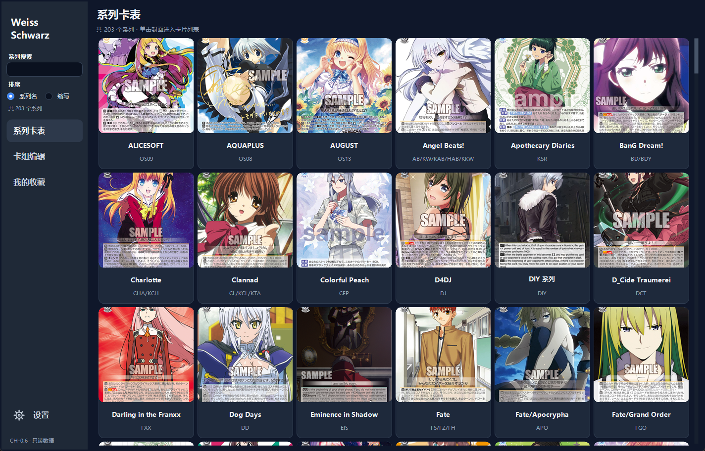
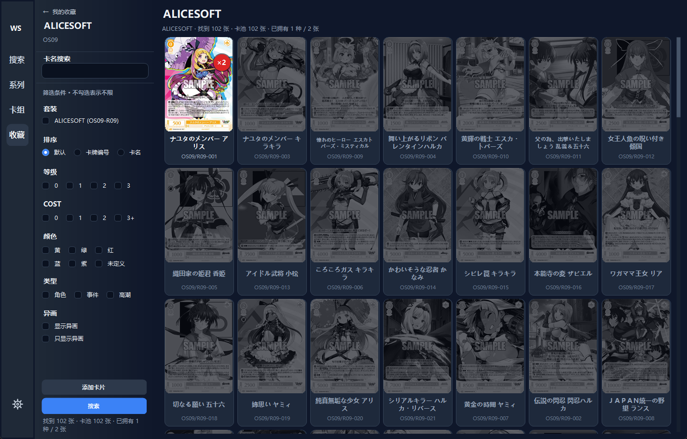

# WS-CN 工具集

给《Weiss Schwarz》(WS-CN) 游戏配套的一组工具，彼此独立，可以只用其中一个：

| 组件 | 说明 | 位置 |
| --- | --- | --- |
| **DeckBuilder** | 独立的 WinForms 卡牌检索 / 构筑 / 导出程序，直接读游戏目录里的 `StreamingAssets`，不需要游戏运行 | `DeckBuilder\`（程序在 `DeckBuilder\dist\`） |
| **WeissSchwarzDeckSync** | BepInEx 插件，把 DeckBuilder 保存的卡组和游戏内卡组库（注册表 PlayerPrefs）双向同步 | 源码 `DeckBuilder\mod\`，DLL `BepInEx\plugins\WeissSchwarzDeckSync\`，配置 `BepInEx\config\ws.deckbuilder.decksync.cfg` |
| **WeissSchwarzSkin** | 界面/皮肤增强 BepInEx 插件（本仓库只提供编译产物与示例皮肤） | `BepInEx\plugins\WeissSchwarzSkin\` |





## 快速开始

1. 取发布包 `WeissDeckBuilder-<版本>.zip`（GitHub Releases，或自己用 `DeckBuilder\package.ps1` 打一个）；
2. 解压到游戏目录，得到 `<游戏目录>\DeckBuilder\`（和 `Weiss Schwarz.exe` 同一层）；
3. 二选一：
   - 双击 `DeckBuilder\安装.cmd`：校验程序与卡表目录，并把卡组同步插件装到 `BepInEx\plugins\`；
   - 直接运行 `DeckBuilder\dist\WeissDeckBuilder.exe`（不需要插件、不需要 BepInEx）。
4. 想用插件/皮肤，需要先装 **BepInEx 5.4.23.x**（本仓库不分发 BepInEx 本体）。

游戏目录长这样（Steam 版）：

```
...\steamapps\common\Weiss Schwarz\
  Weiss Schwarz.exe
  Weiss Schwarz_Data\
  DeckBuilder\            <- 解压这里
  BepInEx\                <- 装过 BepInEx 才有
```

## 程序怎么找卡表

DeckBuilder 启动时按顺序找数据目录，命中条件是「这层目录下存在 `Cards` 子目录」：

1. 命令行 `--data "<路径>"`（可给 `StreamingAssets` 或它的 `Cards`）；
2. 环境变量 `WS_DECKBUILDER_DATA`；
3. 程序目录（`DeckBuilder\dist\`）下的 `data-root.txt`，支持相对路径；
4. 从程序目录、当前工作目录各自向上最多 5 层找 `Weiss Schwarz_Data\StreamingAssets` 或 `StreamingAssets`。

所以它**不认盘符、Steam 库位置、游戏文件夹名**：换电脑、换盘、改文件夹名都不用改配置。
唯一的硬要求是把 `DeckBuilder` 文件夹放在游戏目录里（文件夹名保持 `DeckBuilder`，
导出目录 `Output` 也定位在它旁边）。真要把程序放在游戏目录外，就用 `--data` 或
`install.ps1 -WriteDataRoot`（后者写的是本机绝对路径，换机器要重写）。

## 数据写在哪

| 内容 | 位置 | 说明 |
| --- | --- | --- |
| 卡组 | `StreamingAssets\Decks\<卡组名>.txt` | 插件负责与游戏卡组库双向同步 |
| 暂存卡组 | `StreamingAssets\DeckDrafts\` | 固定 5 个槽位，不进 `Decks`，游戏看不到 |
| 我的收藏 | `StreamingAssets\MyCollocation\<卡包代码>.txt` | 每行 `卡号 数量` |
| 导出卡图 / PDF | `<游戏目录>\Output\` | 与 `DeckBuilder` 同级，可随时删 |
| 游戏内卡组 | 注册表 `HKCU\Software\Blake Thoennes\Weiss Schwarz` | 游戏自身存放，换 Windows 用户不跟随 |
| 插件同步基线 | `BepInEx\plugins\WeissSchwarzDeckSync\deck-sync-state.txt` | 删掉会重新做一次全量对比 |

本仓库**不含任何游戏数据**：`Weiss Schwarz_Data\`、`Decks\`、`MyCollocation\`、`Output\` 都不在仓库里。

## 从源码构建

构建需要游戏目录里的 `_tools`（Roslyn `csc.exe` 与 .NET Framework 4.7.2 参考程序集），
所以先把游戏装好、把本仓库放到能访问它的位置：

```powershell
$game = "E:\Weiss Schwarz CH-0.6"

# 主程序 -> DeckBuilder\dist\WeissDeckBuilder.exe
powershell -NoProfile -ExecutionPolicy Bypass -File DeckBuilder\build.ps1 -GameRoot $game

# 同步插件 -> DeckBuilder\mod\plugin\，并安装到 BepInEx\plugins\（-NoInstall 只编译）
powershell -NoProfile -ExecutionPolicy Bypass -File DeckBuilder\mod\build.ps1 -GameRoot $game

# 冒烟测试（-List 列出分组，-Group deck,export 只跑几组，-Rebuild 强制重编译）
powershell -NoProfile -ExecutionPolicy Bypass -File DeckBuilder\run-tests.ps1 -GameRoot $game
```

- 三个脚本默认把「脚本所在目录的上一级」当游戏目录；**仓库本身放在 `<游戏目录>\_repo` 时
  必须显式传 `-GameRoot`**，否则找不到 `_tools`。
- 编译产物（`build\`、`dist\`、`tests\dist\`、`mod\plugin\`）都已在 `.gitignore` 里，不进仓库。
- 测试中依赖卡表的分组会自动向上找 `StreamingAssets`；找不到时只打印
  「找不到游戏数据，依赖卡表的分组已跳过」，其余分组照常跑。

## 打包发布

```powershell
powershell -NoProfile -ExecutionPolicy Bypass -File DeckBuilder\package.ps1
```

版本号读 `DeckBuilder\version.txt`（也可 `-Version 1.2.3` 覆盖），产物是
`DeckBuilder\dist\WeissDeckBuilder-<版本>.zip`（约 5.6 MB）：解开就是一个 `DeckBuilder\`
文件夹，丢进游戏目录即可，里面已经带好 exe、`SharpCompress.dll`、插件 DLL、安装脚本和截图。
打包脚本会自检，绝不会把 `data-root.txt`、`build\`、`tests\`、日志或 `*.bak-*` 塞进去。

## 维护：这个仓库是游戏目录的一份副本

日常开发、构建、打测试都在游戏目录里进行，改完再同步进来：

```powershell
# 先干跑一遍，看看会复制什么
powershell -NoProfile -ExecutionPolicy Bypass -File tools\sync-from-game.ps1 -DryRun

# 真正同步（默认游戏目录 = 本仓库的上一级，别处用 -GameRoot 指定）
powershell -NoProfile -ExecutionPolicy Bypass -File tools\sync-from-game.ps1

git status --short
```

同步只复制源码、脚本、配置和插件 DLL；`build\`、`dist\`、`tests\dist\`、`mod\plugin\`、
`deck-sync-state.txt`、`dumps\` 一律跳过，所以仓库里不会出现构建垃圾或本机路径。

改完怎么提交、平时怎么备份、怎么发新版本（打 tag + GitHub Release 上传 zip），
见 [`docs/维护与发布流程.md`](docs/维护与发布流程.md)（含逐条命令和检查清单）。

## 文档

| 文档 | 内容 |
| --- | --- |
| [`docs/维护与发布流程.md`](docs/维护与发布流程.md) | 日常更新、备份、发新版本、回滚的完整流程与检查清单 |
| [`DeckBuilder/README.md`](DeckBuilder/README.md) | 程序功能、安装、打包、目录结构、当前限制 |
| [`DeckBuilder/mod/README.md`](DeckBuilder/mod/README.md) | 同步插件的配置项（13 个键）与同步规则 |
| [`DeckBuilder/THIRD_PARTY_NOTICES.md`](DeckBuilder/THIRD_PARTY_NOTICES.md) | 随程序分发的第三方组件许可 |

## 许可与致谢

- `DeckBuilder\lib\SharpCompress.dll`：SharpCompress（MIT），详见 `THIRD_PARTY_NOTICES.md`；
- BepInEx 5.4.23.x（LGPL-2.1）只作为运行环境，本仓库不分发它的二进制；
- 卡牌名称、卡图与游戏本身版权归原权利方所有，本仓库不包含任何游戏资源。

